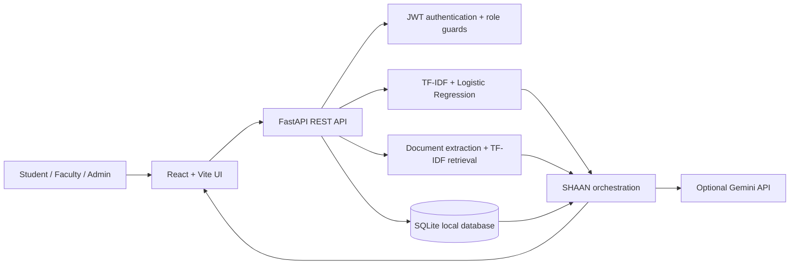

# CampusVerse + SHAAN AI — Architecture

## System context

## Main modules
- `frontend/src/App.jsx`: authentication, navigation, dashboards, academic record views, document upload and SHAAN chat drawer.
- `backend/app/main.py`: REST routes, Pydantic request validation, role-protected actions and API orchestration.
- `backend/app/db.py`: local SQLite schema and demo seed records.
- `backend/app/services/security.py`: scrypt password hashes, signed JWTs and role dependencies.
- `backend/app/services/shaan.py`: intent-based answer flow and optional Gemini response generation.
- `backend/app/services/knowledge.py`: text chunking and TF-IDF retrieval from uploaded public campus documents.
- `backend/app/ml/train.py`: training entry point.
- `backend/app/ml/evaluate.py`: stratified holdout evaluation report.

## Data model
Users have roles (`student`, `faculty`, `admin`). Courses link to faculty and enrollment records. Attendance records refer to a student, course, date and status. Timetable entries connect a course to day/time/room and cohort. Assignments have submissions per student. Exams, events, notices, documents, conversations and audit events are stored separately.

## Trust boundaries
- Only registered and authenticated users can access personal academic APIs and SHAAN chat.
- Public registration can only create student accounts.
- Faculty/admin actions use server-side role checks; hiding a UI control is not considered authorization.
- The role promotion utility is intended for trusted local shell access only.
- Uploaded documents should be official public campus material only. Do not upload confidential or personal records in this build.
- Seeded timetable/exam/assignment/event data is illustrative and must be replaced with verified campus records.

## Current limitations
- SQLite is the local default. PostgreSQL migrations and schema versioning are not implemented yet.
- No college SSO, email verification, password reset, refresh tokens or rate limiting yet.
- The retrieval implementation uses lexical TF-IDF similarity, not dense embeddings; scanned PDFs require OCR which is not included.
- Gemini integration is optional and can fail; responses need evaluation and guardrails before real institutional use.
- No public cloud deployment has been performed from this environment.
